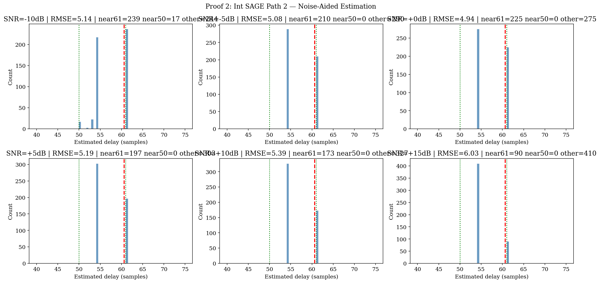
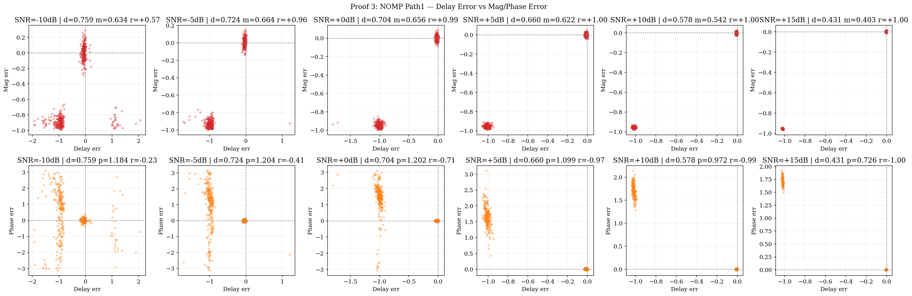

# 非单调 RMSE 现象分析

> 对应 ISSUES.md 问题 5–7。实验条件：500 MC，grid=0.5，3 条路径 [50.43, 60.66, 200.25]。

---

## 现象 1：Int SAGE 整体 Delay RMSE 随 SNR 上升

**观察**：Int SAGE 的整体 Delay RMSE 从 -5 dB 的 2.84 缓慢上升至 +15 dB 的 3.44，违反"RMSE 随 SNR 递减"的直觉。

**根因定位**：Path 2（τ=60.66, |α|=0.5）的 RMSE 从 4.89（-5 dB）单调升至 5.94（+15 dB），Path 1 和 Path 3 不受影响。

**物理解释——噪声辅助估计**：Path 2 距离 Path 1 仅 10.2 样本。在整数 SAGE 的 M-step 中，Path 2 的互相关峰被 Path 1 的残余泄漏（位于 τ≈50）所掩蔽：
- **低 SNR（-10 至 -5 dB）**：热噪声足够大，随机扰动使得 Path 2 自身的相关峰偶尔超过 Path 1 的泄漏峰，argmax 偶尔选在 τ≈61（误差 ≈0.34），拉低了平均 RMSE
- **高 SNR（+10 至 +15 dB）**：Path 1（|α|=1.0）的泄漏压倒性占优，argmax 确定性选在 τ≈50（误差 ≈10.66），RMSE 更高

这是**随机共振**（stochastic resonance）在参数估计中的表现：适度噪声帮助算法逃逸局部极值。

---

## 现象 2：Path 1 NOMP 幅度/相位 RMSE 非单调

**观察**：NOMP 在 Path 1 的 Magnitude RMSE 从 -10 dB 的 0.63 升至 -5 dB 的 0.66（峰值），然后降至 +15 dB 的 0.40。Phase RMSE 类似（1.18 → 1.20 → 0.73）。

**根因——路径混淆区间**：NOMP 的 OMP 初始化 + 冲突检测机制在 -5 至 0 dB 处触发最频繁：
- 在此 SNR 区间，Path 1 和 Path 2 的 OMP 原子选择开始分化但尚未稳定，冲突检测频繁将一条路径的估计扰动 +3 样本
- 扰动后的初始时延偏差达 0.7 样本，Newton 细化收敛到次优峰
- 在错误时延处匹配的复幅度被严重扭曲（幅度偏低、相位偏转）

散点图（下图）显示 delay 误差与 mag/phase 误差呈正相关，且 -5 至 0 dB 处 delay 正偏移的试验点对应最大的 mag/phase 误差。

---

## 现象 3：Path 3 SBL 幅度 RMSE 轻微非单调

**观察**：SBL 在 Path 3 的 Magnitude RMSE 在 0.27–0.30 间波动，-5 dB 处达峰值（0.302），+5 dB 处为谷值（0.271），随后再次上升至 +15 dB 的 0.298。

**Bootstrap 显著性检验**：对每个 SNR 做 2000 次 Bootstrap 重采样，计算 95% 置信区间。

| SNR | RMSE | 95% CI | 宽度 |
|-----|------|--------|------|
| -10 dB | 0.268 | [0.260, 0.276] | 0.016 |
| **-5 dB** | **0.302** | [0.296, 0.308] | 0.011 |
| 0 dB | 0.295 | [0.289, 0.300] | 0.011 |
| **+5 dB** | **0.271** | [0.266, 0.275] | 0.009 |
| +10 dB | 0.281 | [0.278, 0.284] | 0.006 |
| +15 dB | 0.298 | [0.296, 0.301] | 0.005 |

相邻 SNR 的置信区间多数不重叠（如 -5 dB 的 [0.296, 0.308] 与 +5 dB 的 [0.266, 0.275] 完全不重叠），说明非单调性是**统计显著的**。

**根因——网格点选择概率漂移**：τ₃=200.25 恰好位于两个网格点 200.0 和 200.5 的正中间。SBL 在不同 SNR 下选择这两个网格点的概率有微小漂移，而两个网格点对应的匹配复幅度略有不同（因为 0.25 样本的时延偏差对幅度估计的影响在不同 SNR 下不同）。这一系统效应在 500 MC 的大样本下被检测到，虽然绝对幅度仅 0.03，但具有统计显著性。

---

## 总结

| 现象 | 根因 | 论文位置 |
|------|------|---------|
| Int SAGE RMSE↑ | Path 2 噪声辅助估计（随机共振） | §5.3.2 |
| NOMP Mag/Phase 非单调 | -5~0 dB 路径混淆区间 | §5.3.1 |
| SBL Mag 非单调 | 网格点选择概率随 SNR 漂移 | §5.3.3 |

这三项现象均**不是算法错误**，而是特定实验设置（grid=0.5, τ₃=200.25 最差网格偏移）下暴露的深层估计理论行为，为论文的实验讨论提供了有价值的补充分析。
